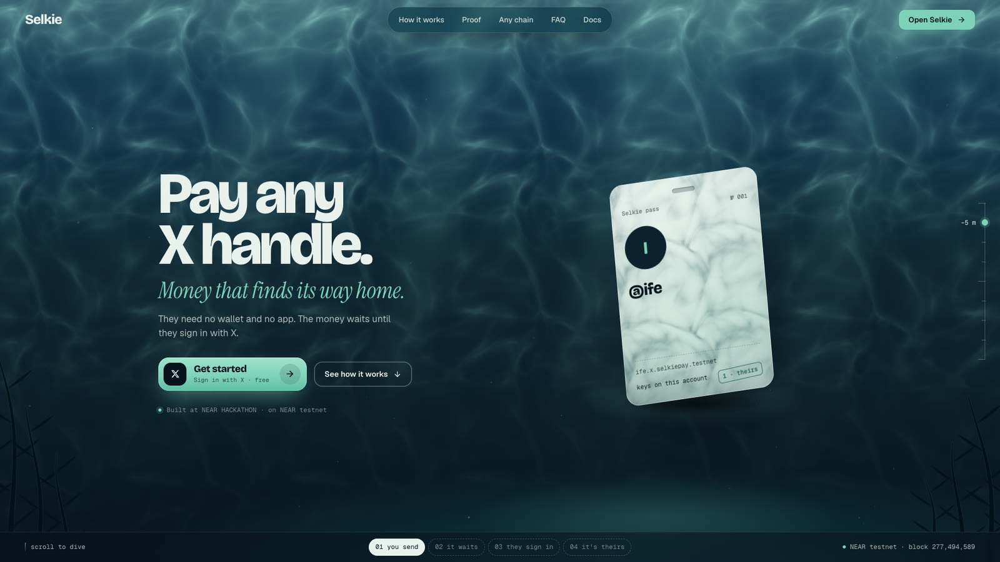
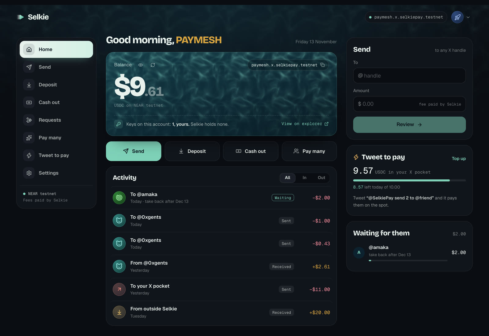
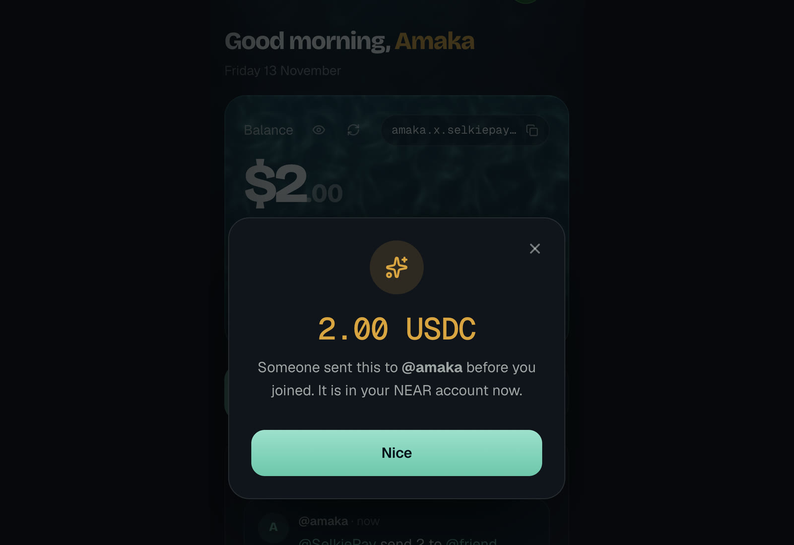
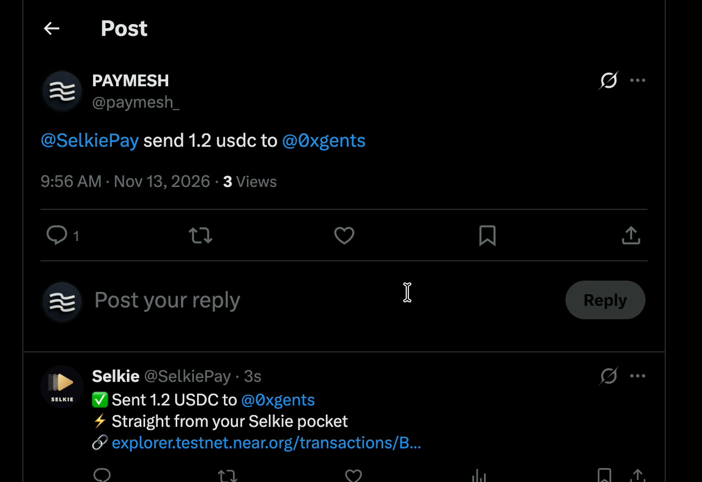
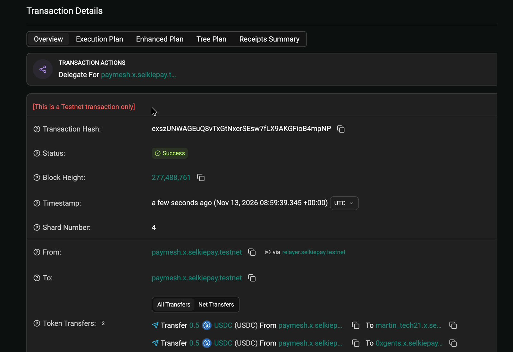
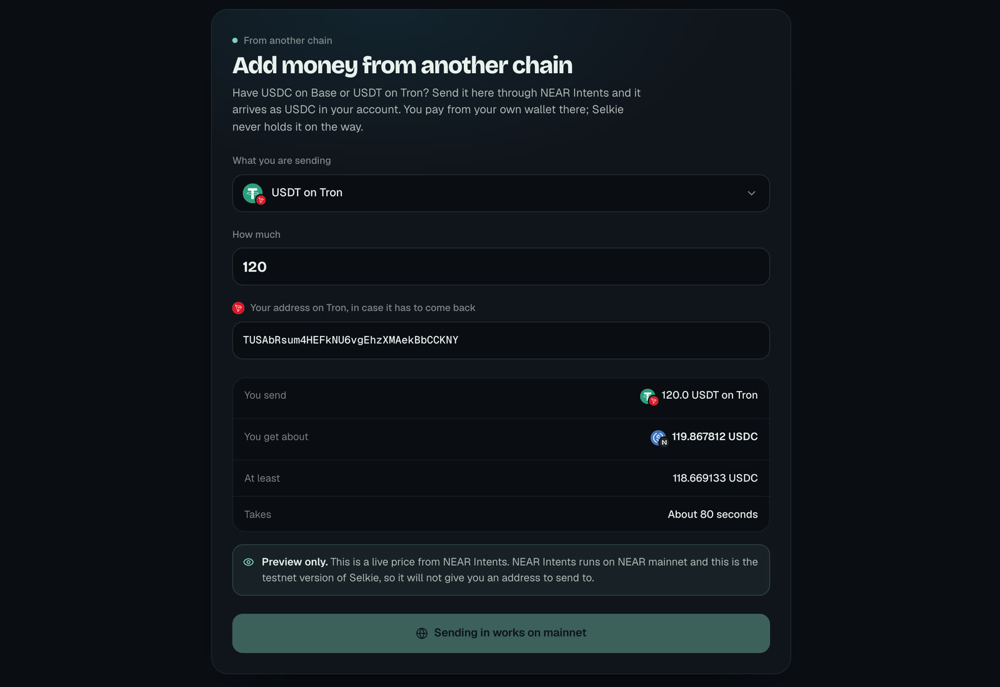
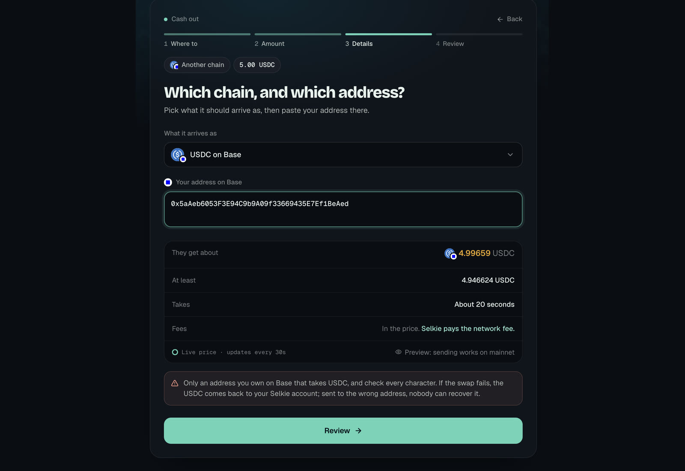
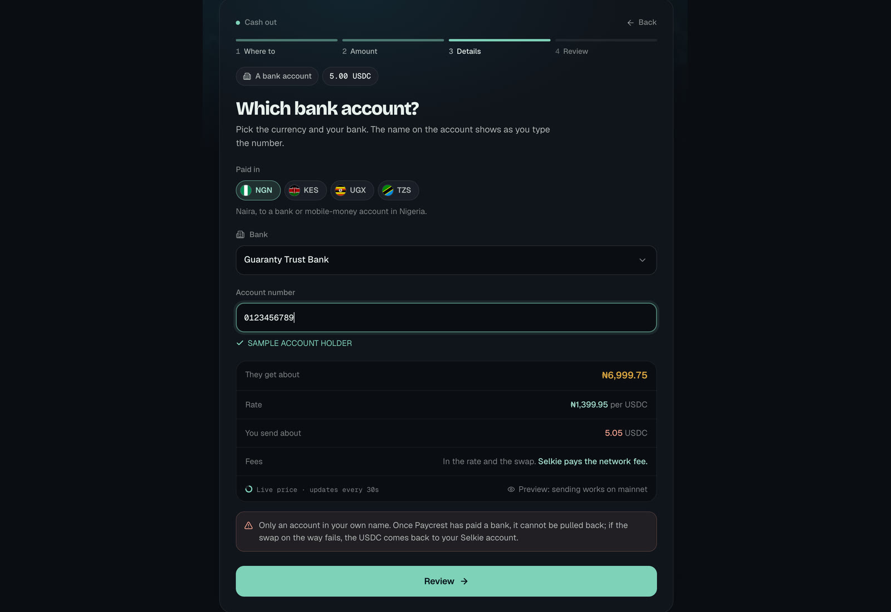
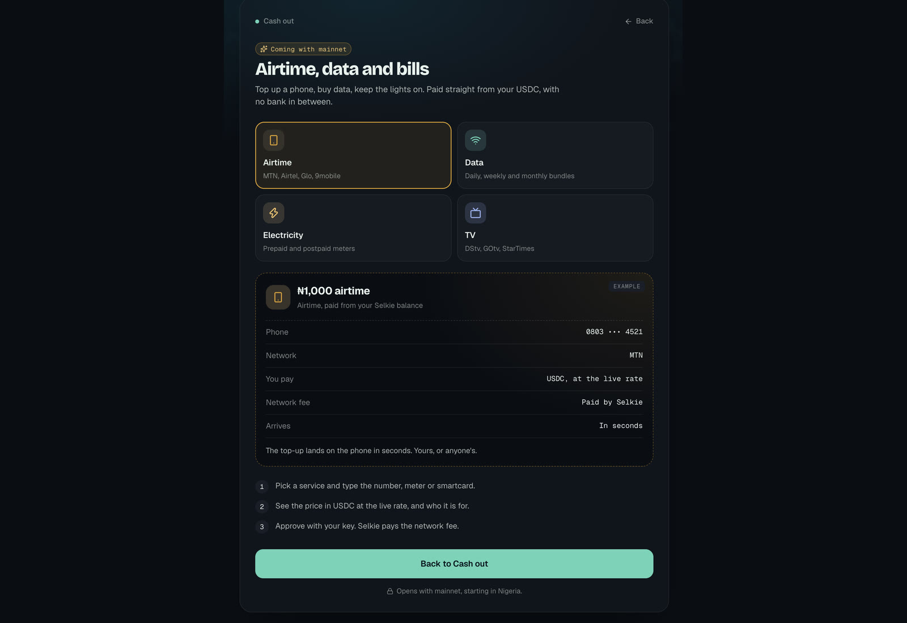
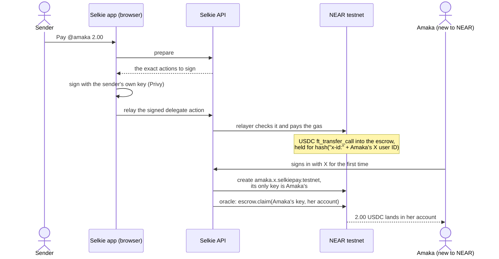

<p align="center">
  <a href="https://selkiepay.com">
    <picture>
      <source media="(prefers-color-scheme: dark)" srcset="assets/brand/selkie-lockup-dark.svg" />
      
    </picture>
  </a>
</p>

<p align="center">
  <b>Send money to any X handle.</b><br/>
  The person you pay needs no wallet, no app and no gas. Built on NEAR.
</p>

<p align="center">
  <a href="https://selkiepay.com"></a>
  
  
  
  <a href="LICENSE"></a>
</p>

<p align="center">
  <a href="https://selkiepay.com"><b>Live app</b></a> ·
  <a href="https://selkiepay.com/docs"><b>Docs</b></a> ·
  <a href="https://x.com/SelkiePay"><b>@SelkiePay on X</b></a> ·
  <a href="#see-it"><b>Screenshots</b></a> ·
  <a href="#check-it-in-2-minutes"><b>Check it in 2 minutes</b></a>
</p>

<p align="center">
  <a href="https://selkiepay.com"></a>
</p>

To pay someone in crypto you need their address, and most people don't have one.
With Selkie you pay **@amaka** instead. If Amaka has never used NEAR, the dollars
(USDC) wait in an escrow contract. When she signs in with that X account, she gets
a real NEAR account named after her handle, `amaka.x.selkiepay.testnet`, and the
money moves into it. **Its only key is hers. Selkie holds none, and pays every
network fee.**

You can also pay from a tweet: `@SelkiePay send 2 to @amaka` pays on the spot from
a small pocket with a daily limit the chain enforces. And money can come in from,
or go out to, ten other chains through NEAR Intents, or out to a bank in Nigeria,
Kenya, Uganda or Tanzania.

Built at **NEAR HACKATHON**. Tracks: realworld (primary), agents (the X bot pays
from a capped on-chain pocket), social (DAO payouts by X handle). Runs on NEAR
testnet; [mainnet is set up and waiting](#mainnet).

## Contents

[What makes it different](#what-makes-it-different) ·
[See it](#see-it) ·
[Check it in 2 minutes](#check-it-in-2-minutes) ·
[Try it](#try-it-on-the-hosted-app) ·
[How it works](#how-it-works) ·
[Tweet to pay](#tweet-to-pay) ·
[Trust model](#trust-model) ·
[Run it locally](#run-it-locally) ·
[Tests](#tests) ·
[Accounts](#contracts-and-accounts-testnet) ·
[Disclosure](#disclosure)

## What makes it different

| | |
| --- | --- |
| **Selkie holds no key to your account** | Your key is your Privy embedded NEAR wallet, made in your browser. The account is created with that key as its only key. Anyone can check this on the explorer. |
| **Your handle becomes your account** | @amaka gets `amaka.x.selkiepay.testnet`. Only someone who proved that X login can get a name under `x.`, so nobody can squat it. |
| **Nobody pays gas** | You sign a NEP-366 delegate action; Selkie's relayer pays the fee and submits it. You never hold NEAR. |
| **Any chain in, any chain out** | Add USDC or USDT from Tron, Base, Solana and seven more, or cash out to them, through NEAR Intents (1Click). |
| **Money waits for a person, not a username** | Usernames get renamed and re-registered. The escrow holds money for a hash of the X user ID, so a payment can't be claimed by whoever takes the old name. |
| **Pay from a tweet, safely** | The X bot's key can call one method on one contract: pay from a pocket you filled, up to your daily limit, only to Selkie accounts. |

## See it

Screens from the live app at [selkiepay.com](https://selkiepay.com) on NEAR testnet.

<table>
  <tr>
    <td width="50%"><br/><sub><b>Home.</b> "Keys on this account: 1, yours. Selkie holds none." One tap opens the explorer.</sub></td>
    <td width="50%"><br/><sub><b>First sign-in.</b> $2 was sent to @amaka before she joined. She signs in with X and it's in her NEAR account.</sub></td>
  </tr>
  <tr>
    <td><br/><sub><b>Tweet to pay.</b> "@SelkiePay send 1.2 usdc to @0xgents". The bot pays from the sender's pocket and replies with the transaction.</sub></td>
    <td><br/><sub><b>One signature, relayed.</b> Two people paid in one transaction, signed by the sender, sent "via relayer.selkiepay.testnet".</sub></td>
  </tr>
  <tr>
    <td><br/><sub><b>Add money from another chain.</b> 120 USDT on Tron in, about 119.87 USDC on NEAR out. A live NEAR Intents price.</sub></td>
    <td><br/><sub><b>Cash out to another chain.</b> USDC on NEAR to USDC on Base, with the minimum you'll get and how long it takes.</sub></td>
  </tr>
  <tr>
    <td><br/><sub><b>Cash out to a bank.</b> Naira, shillings: pick the bank, type the number, see the holder's name and the rate before you sign.</sub></td>
    <td><br/><sub><b>Airtime, data and bills.</b> A preview of what comes with mainnet, with an example receipt for each service.</sub></td>
  </tr>
</table>

## Check it in 2 minutes

No account and no secrets needed. You need Node 20.6+.

```bash
git clone https://github.com/SelkieLabs/Selkie && cd Selkie && npm install
npm run prove:keys -- selkiepay.x.selkiepay.testnet
```

The script reads the account's keys from the chain, then every key on every account
Selkie runs, and checks whether the two lists overlap. You see:

```text
Account   selkiepay.x.selkiepay.testnet
Keys      1 on chain (RPC https://test.rpc.fastnear.com)
  ed25519:5JduNAuMCZ73MBPTQ8FNnSitdGprq4UfJAtoRv8AxCXM  full access
Selkie    6 keys across selkiepay.testnet, x.selkiepay.testnet, relayer.selkiepay.testnet, oracle.selkiepay.testnet, escrow.selkiepay.testnet, oracle-v2.selkiepay.testnet

Result    Selkie holds no key to this account. It cannot sign for selkiepay.x.selkiepay.testnet.
```

Then:

1. Open [the account on the explorer](https://explorer.testnet.near.org/accounts/selkiepay.x.selkiepay.testnet). You see the same single full-access key.
2. Open [the X bot's account](https://explorer.testnet.near.org/accounts/pocketbot.selkiepay.testnet). Its only key is a function-call key for `pocket_send` on `pocket.selkiepay.testnet`, and nothing else.
3. Run `npm test`. You see `# pass 505` and `# fail 0`. (Point `DATABASE_URL_TEST` at a throwaway Postgres database and the storage tests join in: 565.)
4. Run `npm run test:contracts:near` (needs Rust). You see `test result: ok. 35 passed` for the escrow and `test result: ok. 34 passed` for the pocket.

## Try it on the hosted app

1. Open [selkiepay.com](https://selkiepay.com) and sign in with X. You see your account, `<your handle>.x.selkiepay.testnet`, and "Keys on this account: 1, yours. Selkie holds none."
2. Tap **Deposit**. Under **From a NEAR wallet**, tap **Open the faucet**, pick NEAR Testnet on faucet.circle.com and paste your account name. Within a minute your balance goes up and the feed shows "From outside Selkie".
3. Tap **Send**, type a handle that has never used Selkie, and send `1.00`. A confirm window lists exactly what you're signing. Then you see "Sent. It is waiting for @them to claim." and a **Waiting** line in your feed.
4. That person signs in with X. Their account is created with their key as its only key, and the `1.00` is in it. On your side, the **Waiting** tag goes away.
5. If nobody claims a payment before it expires, its feed line gets a **Take it back** button. Only your own key can sign that refund.
6. Open **Tweet to pay** and fill your pocket with `1.00`. Then tweet `@SelkiePay send 0.10 to @<someone on Selkie>`. Within about a minute the bot replies "✅ Sent 0.10 USDC to @them ⚡ Straight from your Selkie pocket" with an explorer link.
7. Tap **Cash out**. **A bank account** shows the holder's name, the rate and what arrives, marked "Preview: sending works on mainnet". **Another chain** shows a live NEAR Intents price for USDC or USDT on that chain.

## How it works



**Prepare, sign, relay.** The server says exactly what to sign, the browser signs it
with the user's key, and the relayer pays the gas. The relayer
([`relayer.ts`](packages/chain-near/src/relayer.ts)) submits a signed delegate
action only when all of these hold:

- the signer is the signed-in user's own account;
- the signed bytes match a prepare record made for this user minutes ago (same
  receiver, method, arguments and deposit), and each record works once;
- the method is on a short list: `ft_transfer`, `ft_transfer_call` and
  `storage_deposit` on USDC, `refund` on the escrow, `pocket_withdraw` and
  `pocket_set_cap` on the pocket;
- a cash-out to another chain or a bank pays only the deposit address of a 1Click
  quote the server itself requested;
- the deposit is at most 1 yoctoNEAR, gas is capped, and each user is rate-limited.

**The escrow** ([`contracts-near/handle-escrow`](contracts-near/handle-escrow/src/lib.rs))
takes `ft_transfer_call` deposits for one person (`hold`) or many (`hold_many`).
Only the oracle can release them, and the sender can take them back after expiry.
It removes a payment before transferring it and restores it in a callback if the
transfer fails, and it emits NEP-297 events so a send can be matched to its claim.

### What's new at NEAR HACKATHON

All of it: [compare/3525dc8...main](https://github.com/SelkieLabs/Selkie/compare/3525dc8...main).

| Feature | Where it lives |
| --- | --- |
| Selkie holds no keys | [`chain.ts`](packages/chain-near/src/chain.ts) (`createHandleAccount`), [`identity-chain.ts`](backend/api/src/near/identity-chain.ts), [`prove-keys.ts`](packages/chain-near/scripts/prove-keys.ts), [`KeyProof.tsx`](frontend/src/components/wallet/KeyProof.tsx) |
| Handle accounts | [`names.ts`](packages/chain-near/src/names.ts): name rules, collisions |
| Gasless (NEP-366) | [`browser.ts`](packages/chain-near/src/browser.ts), [`delegate.ts`](packages/chain-near/src/delegate.ts), [`relayer.ts`](packages/chain-near/src/relayer.ts) |
| Any chain in and out | [`intents.ts`](packages/chain-near/src/intents.ts), [`near/intents.ts`](backend/api/src/near/intents.ts), [`OtherChain.tsx`](frontend/src/components/wallet/OtherChain.tsx) |
| Payments wait for an X user ID | [`handle.ts`](packages/core/src/domain/handle.ts), [`recipient.ts`](packages/chain-near/src/recipient.ts), [`x-lookup.ts`](backend/api/src/near/x-lookup.ts), [`x-handle.ts`](backend/api/src/near/x-handle.ts) |
| Escrow contract | [`contracts-near/handle-escrow`](contracts-near/handle-escrow/src/lib.rs) |
| Tweet to pay: pocket contract and bot | [`contracts-near/pocket`](contracts-near/pocket/src/lib.rs), [`pocket.ts`](packages/chain-near/src/pocket.ts), [`near/pocket.ts`](backend/api/src/near/pocket.ts), [`respond.ts`](backend/bot/src/respond.ts), [`PocketPanel.tsx`](frontend/src/components/wallet/PocketPanel.tsx) |
| Cash out to a bank (Paycrest) | [`paycrest.ts`](backend/api/src/near/paycrest.ts), [`bank.ts`](backend/api/src/near/bank.ts), [`BankFields.tsx`](frontend/src/components/wallet/cashout/BankFields.tsx) |
| Pay many with one signature | one delegate action: direct transfers to Selkie users, one `hold_many` for everyone else |
| DAO payouts | [`dao-payout.ts`](packages/chain-near/scripts/dao-payout.ts): a CSV of `@handle,amount` becomes one Sputnik DAO proposal |
| Notices when money arrives | Web Push and email, plus feed lines for money from outside Selkie |
| RPC failover | [`rpc.ts`](packages/chain-near/src/rpc.ts): skips a rate-limited endpoint, never retries a real answer |

### Why NEAR

- **Named accounts.** A payment shows `amaka.x.selkiepay.testnet`, not a 64-character hex string.
- **Several keys per account, all visible on chain.** Selkie adds exactly one, the user's, and anyone can check.
- **Function-call keys.** The bot and the oracle each hold a key for one method on one contract. That is what makes a bot that spends money safe to run.
- **NEP-366 meta-transactions.** Users sign, Selkie pays, nobody needs a gas token.
- **NEP-141 `ft_transfer_call`.** The escrow and the pocket receive money and record whose it is in one atomic step.
- **NEAR Intents.** One API for money in from, and out to, the chains people already use, and the bridge to a bank payout.

## Tweet to pay

Fill a small pocket once, then pay from X. The bot reads mentions every 15 seconds
or so and replies in the thread.

| Tweet | What happens |
| --- | --- |
| `@SelkiePay send 5 to @amaka` | Pays from your pocket on the spot if @amaka is on Selkie, and replies with the explorer link. Otherwise it replies with a link that opens Send filled in, for you to sign; if @amaka hasn't joined, the money waits for her. |
| `@SelkiePay send 5 to @amaka for lunch` | The same, with the note as the payment's memo. |
| `@SelkiePay request 5 from @amaka` | @amaka finds the request under **Requests** with a Pay button. Nothing moves until she pays. |
| `@SelkiePay balance` | "🔒 That one stays private" and a link. A public reply never shows anyone's money. |
| `@SelkiePay help` | The list of commands. |

What the bot **can't** do, and where that is enforced:

- **Spend from your account.** Only from a pocket you filled yourself ([`contracts-near/pocket`](contracts-near/pocket/src/lib.rs)).
- **Go over your limit.** At most your daily limit per UTC day (10 USDC unless you change it; 0 pauses it). Checked on chain.
- **Pay an address of its choice.** Only `*.x.selkiepay.testnet` accounts, which exist only for people who proved an X login. Checked on chain.
- **Withdraw, raise a limit or move its own NEAR.** Its key is a function-call key for `pocket_send` only.
- **Pay a tweet twice.** The API records each tweet ID and pays it once ([`near/pocket.ts`](backend/api/src/near/pocket.ts)).

## Trust model

| Who | Can | Cannot |
| --- | --- | --- |
| Relayer key | pay gas for actions the user signed | create or change what the user signed |
| Account creator (`x.`) | create a new handle account with the user's key | add a key to an existing account, move user money |
| Oracle key (`claim` only) | release waiting money to whoever proved that X login | take money, change amounts, block a refund |
| Escrow contract | hold money for a recipient, refund the sender after expiry | release to anyone except through the oracle |
| X bot key (`pocket_send` only) | pay Selkie accounts from a pocket, up to its daily limit | touch money outside pockets, withdraw, change a limit |
| Pocket contract | hold what each user parked, return it whenever they ask | let anyone but the owner withdraw or change the limit |
| Privy | holds the user's key material (their custody model) | — Selkie turns on no server-side signers |

Limits, stated plainly:

- **The oracle is a trust point.** A stolen oracle key could send *waiting* money to the wrong account. It can't touch money already in anyone's account.
- **The bot is a smaller one.** A stolen bot key could pay real Selkie users up to each pocket's daily limit. Keep pockets small; that's what they're for.
- **Users trust Privy** for key custody.
- **Testnet.** NEAR Intents and bank payouts show live previews, because 1Click runs on mainnet only. Bank payouts also wait on Paycrest's business approval.
- **The bot is one process** on the builder's machine for now. If it isn't running, a tweet gets no reply and nothing moves.

## Run it locally

You need Node 20.6+, Postgres, Rust (1.93+ with the `wasm32-unknown-unknown`
target), and a [Privy](https://dashboard.privy.io) app with **X** login and
embedded wallets turned on.

```bash
git clone https://github.com/SelkieLabs/Selkie && cd Selkie
npm install
cp .env.example .env                           # set PRIVY_APP_ID, PRIVY_APP_SECRET
cp frontend/.env.example frontend/.env.local   # set NEXT_PUBLIC_PRIVY_APP_ID
createdb selkie_near
echo 'NEAR_DATABASE_URL=postgres://localhost:5432/selkie_near' >> .env

# 1. Testnet accounts. Pick a root name nobody has taken. The faucet funds it;
#    each child gets a fresh key appended to .env (never printed).
NEAR_ROOT_ACCOUNT=<yourname>.testnet npm run near:setup

# 2. Build both contracts, then deploy them.
npm run build:contracts:near
npm run near:deploy-escrow
npm run near:deploy-pocket                     # only needed for Tweet to pay

# 3. The API in NEAR mode (it runs its migrations on start).
SELKIE_CHAIN=near PORT=4100 npx tsx --env-file=.env backend/api/src/index.ts
curl localhost:4100/health                     # {"ok":true,"chain":"near","network":"testnet"}

# 4. The web app, in another terminal. Open http://localhost:3000 and sign in with X.
SELKIE_API_ORIGIN=http://localhost:4100 npm run dev:web
```

Optional settings are all in [`.env.example`](.env.example), one line on each:
`NEAR_POCKET_*` (Tweet to pay), `ONECLICK_*` (other chains), `PAYCREST_*` (bank
cash-out), `X_BEARER_TOKEN` (payments that wait for an X user ID).

**The X bot.** It never posts unless you say so:

```bash
# .env needs X_API_KEY, X_API_SECRET, X_ACCESS_TOKEN, X_ACCESS_SECRET for the bot's
# X account, and SELKIE_BOT_SECRET (32+ characters, the same value the API has).
SELKIE_CHAIN=near SELKIE_API_URL=http://localhost:4100 SELKIE_WEB_URL=http://localhost:3000 npm run dev:bot
# You see "Selkie bot on NEAR: ...". Replies are printed, not posted.
# SELKIE_BOT_DRY_RUN=0 makes it post for real.
```

## Tests

| Command | What it proves |
| --- | --- |
| `npm test` | 505 tests (565 with `DATABASE_URL_TEST`): amounts, account names, recipient keys, building and verifying delegate actions, the relay rules, RPC failover, the 1Click and Paycrest clients, the pocket routes, and every bot reply (each fits in a tweet). The NEAR API also runs end to end on a simulated chain with real ed25519 signatures. |
| `npm run test:contracts:near` | 35 escrow tests (hold and claim, hold_many, wrong token, bad message refunded, non-oracle claim refused, double claim paid once, refund rules, a failed transfer restoring the payment) and 34 pocket tests (only the bot sends, daily limit per UTC day, only to handle accounts, only the owner withdraws, a failed transfer restoring the pocket). |
| `npm run test:live:near` | The whole money path on real testnet: hold, create an account with a brand-new key, prove Selkie holds none of its keys, claim, refund. Needs 0.02 test USDC in your root account. |
| `npm run test:live:near:pocket` | The pocket on real testnet: the bot key is refused for anything but `pocket_send`, then top up, send, over-limit refusal, withdraw. Needs 1 test USDC. |
| `npm run prove:keys -- <account>` | Whether Selkie holds any key to an account, read from the chain. |

## Contracts and accounts (testnet)

| Account | Role |
| --- | --- |
| [escrow.selkiepay.testnet](https://explorer.testnet.near.org/accounts/escrow.selkiepay.testnet) | the handle-escrow contract |
| [pocket.selkiepay.testnet](https://explorer.testnet.near.org/accounts/pocket.selkiepay.testnet) | the pocket contract (Tweet to pay) |
| [pocketbot.selkiepay.testnet](https://explorer.testnet.near.org/accounts/pocketbot.selkiepay.testnet) | the X bot; its only key can call `pocket_send` and nothing else |
| [x.selkiepay.testnet](https://explorer.testnet.near.org/accounts/x.selkiepay.testnet) | parent of every handle account; only creates accounts |
| [relayer.selkiepay.testnet](https://explorer.testnet.near.org/accounts/relayer.selkiepay.testnet) | pays gas for users' delegate actions |
| [oracle-v2.selkiepay.testnet](https://explorer.testnet.near.org/accounts/oracle-v2.selkiepay.testnet) | releases waiting money; its only key can call `escrow.claim` |
| [selkiepay.testnet](https://explorer.testnet.near.org/accounts/selkiepay.testnet) | root; used by setup scripts only |
| `3e2210e1…cb8af` | Circle's USDC on NEAR testnet (6 decimals) |
| [selkie-payouts.sputnikv2.testnet](https://explorer.testnet.near.org/accounts/selkie-payouts.sputnikv2.testnet) | test DAO for payouts |

The first tweet the bot paid: [`HdzoKjfK…`](https://explorer.testnet.near.org/transactions/HdzoKjfKuVLnWfc8E8purQqeNkqquhJ4B86X6vg9k2Pe).

## Mainnet

Testnet and mainnet differ only by configuration.

- `npm run near:setup:mainnet` prints the plan and its cost and changes nothing. With `--execute` and `SELKIE_MAINNET_OK=yes` it creates `x.`, `escrow.`, `relayer.` and `oracle.` under `selkiepay.near`, with keys in `.env.mainnet`. USDC's contract is read from 1Click's token list, never typed in.
- `npm run near:deploy-escrow:mainnet` deploys the escrow there.
- On mainnet, **Add money** and **Another chain** move real money through 1Click, and **A bank account** pays out through Paycrest.
- **Coming with mainnet:** airtime, data and bills, starting in Nigeria (MTN, Airtel, Glo, 9mobile; prepaid and postpaid meters; DStv, GOtv, StarTimes), paid the same way as everything else: prepared, signed by you, relayed ([`Bills.tsx`](frontend/src/components/wallet/cashout/Bills.tsx)).

Not done yet: the mainnet root account, the deploys, and Paycrest's business approval.

## Project layout

```
frontend/              the web app: Next.js 16, Tailwind, Privy
backend/
  api/                 Fastify API; NEAR routes in src/near/
  bot/                 the X bot
packages/
  core/                chain-agnostic: handles, money, the ChainAdapter interface
  chain-near/          the only code that imports NEAR SDKs (+ a browser signer)
  chain-stellar/       the Stellar adapter (pre-hackathon)
contracts-near/        NEAR contracts: handle-escrow, pocket
contracts/             the Soroban escrow (pre-hackathon)
```

How the layers fit and why: [ARCHITECTURE.md](ARCHITECTURE.md).

## Built with

near-api-js 7.4 · near-sdk 5.29 (Rust) · NEAR Intents 1Click API · Privy
(`@privy-io/react-auth` 3.36) · Next.js 16 and React 19 · Tailwind CSS ·
lucide-react · lenis · qrcode · Fastify 5 and `@fastify/rate-limit` · pg ·
web-push · Paycrest API · X API v2 · Resend

## Disclosure

Selkie existed before the hackathon as a Stellar app. The first commit,
[`3525dc8`](https://github.com/SelkieLabs/Selkie/commit/3525dc8), is that
baseline: the web app, the Fastify API, the X bot, the Soroban escrow and the
Stellar adapter. Everything NEAR was built during the hackathon and is in the
[diff](https://github.com/SelkieLabs/Selkie/compare/3525dc8...main):
`contracts-near/`, `packages/chain-near/`, `backend/api/src/near/`, the NEAR mode
of the web app and the X bot (including Tweet to pay), bank cash-out through
Paycrest, and push and email notices.

The Stellar code is untouched and still runs with `SELKIE_CHAIN=stellar`; its docs
are in [docs/stellar.md](docs/stellar.md). AI coding tools (Claude Code) were used
throughout.

## Licence

[MIT](LICENSE)
